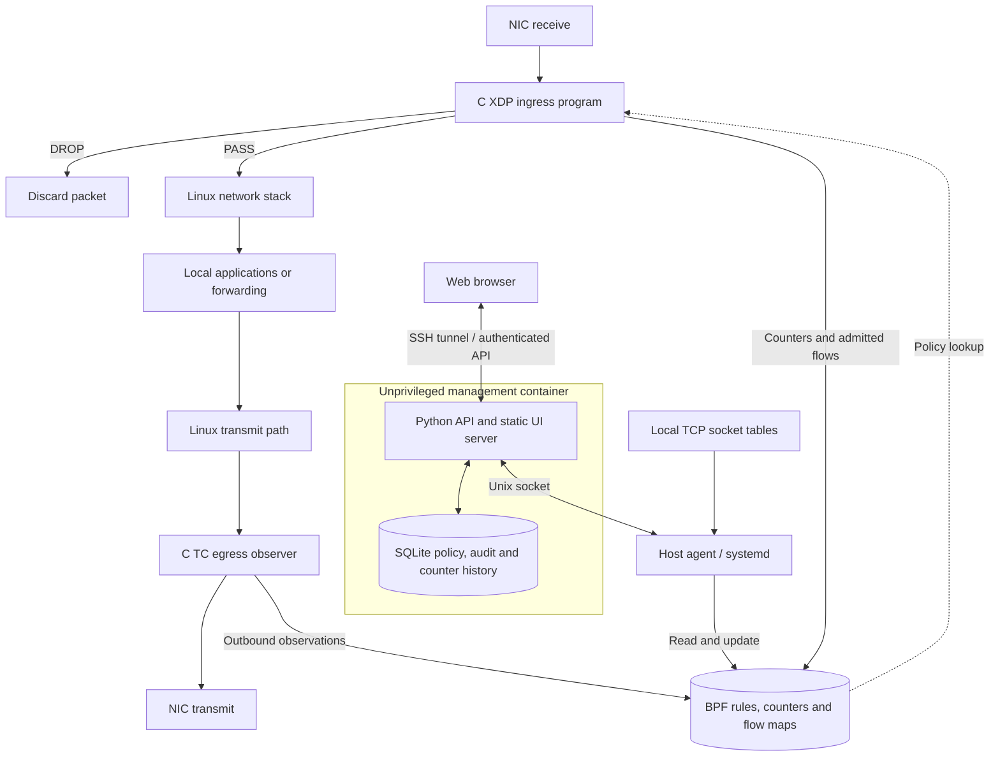

# eBPF XDP Firewall

A single-host firewall prototype with a C XDP ingress program, C TC egress observer,
Python host agent, authenticated API, persistent SQLite policy store and web UI.
The web service runs in an unprivileged Docker container; only the host agent
writes kernel maps. See [architecture and roadmap](docs/PLAN.md) and
[reference review](docs/REFERENCES.md).

**Status: development MVP.** The implemented components are integrated on `main`.
The isolated kernel and container tests pass; full host deployment, browser QA and
physical-NIC acceptance remain outstanding. See [validation results](docs/VALIDATION.md).
Merging the development code does not establish production readiness.

## Architecture

Packet decisions stay local to the kernel. The API, database and UI are outside
the packet path, so an unavailable dashboard does not make each packet wait.



| Component | Runs where | Responsibility |
|---|---|---|
| XDP program | Host kernel, NIC ingress | Source blocks, header parsing, UDP/SYN budgets |
| TC program | Host kernel, NIC egress | Outbound traffic accounting |
| Host agent and loader | Host systemd service | Own attachments, reconcile maps, collect telemetry |
| API and UI | Docker container | Administrative controls, flow views and reports |
| SQLite | Persistent host directory mounted into container | Desired policy, audit and 24-hour counter samples |

Rules are stored before delivery. The controller reconciles with the agent every
five seconds and reports desired/applied revisions separately. Expiring rules use
kernel-checkable deadlines. Updates across multiple maps are not atomic.

## XDP modes and hardware support

| Mode | Where it runs | Use |
|---|---|---|
| `native` | Supported NIC driver's receive path, before socket-buffer allocation | Production performance evaluation |
| `generic` | Kernel compatibility path, after socket-buffer allocation | Development on drivers without native XDP |
| Hardware offload | Compatible NIC hardware | Future work; not implemented |

Native XDP still consumes host CPU and normally participates in NAPI processing.
Driver support and VLAN metadata visibility vary. Generic mode is selected
explicitly; attachment never silently falls back. Monitoring covers traffic that
reaches the chosen interface, not all traffic elsewhere on the network.

## Implemented

- IPv4/IPv6 source blocks: individual addresses, CIDRs, start-end ranges, optional TTL.
- Observation mode by default; explicit enforcement with actual-drop counters.
- Bounded per-CPU UDP and SYN packet budgets. These are interface-wide fixed-window
  limits, not per-service limits or automatic source bans.
- Directional flow records and bidirectional grouping, plus separate kernel-local
  TCP socket states. Forwarded TCP state remains inferred.
- Up to two in-packet VLAN tags and one base RFC7348 VXLAN layer on UDP/4789,
  including inner IPv4/IPv6, tenant identity and inner VLAN tags.
- Rule revisions, pending/applied/error status, audit CSV, 24-hour counter samples.
- Host service lifecycle and single-host Ansible deployment sources.

## Local isolated tests

Requires Docker. The privileged test container has its own network namespace and
never attaches to physical host interfaces. It still uses the host kernel for BPF.

```sh
docker build -f Dockerfile.test -t xdp-firewall-test .
docker run --rm --privileged --network none \
  -v "$PWD:/input:ro,z" xdp-firewall-test sh /input/scripts/test-isolated.sh
```

Tests compile the programs, load them through the kernel verifier, execute packet
fixtures using BPF_PROG_TEST_RUN, test the API and agent, validate Ansible syntax,
and attach/detach on disposable veth interfaces. The test runner works on a copy
of the source and does not place build artifacts in your checkout.

End-to-end management containers:

```sh
docker build -t xdp-firewall-control:test .
docker compose -p xdp-fw-test -f deploy/compose.test.yml up -d
docker compose -p xdp-fw-test -f deploy/compose.test.yml exec -T control \
  python3 - < scripts/compose-smoke.py
docker compose -p xdp-fw-test -f deploy/compose.test.yml down -v
```

The Compose test uses no host network and publishes no ports. Its test token is
public fixture data and must never be used for deployment.

## Single-host setup with Ansible

The Ansible controller can be your workstation; the managed host is the Linux
server that will filter traffic. They may be the same computer using a local
inventory. The playbook targets Debian 12+, Ubuntu 24.04+, or Fedora 42+ on x86-64,
with kernel 6.1+, systemd and a Docker-capable environment. These are package
targets, not a completed physical-hardware compatibility matrix.

### 1. Prepare the controller and managed host

**1.a — Install Ansible and Git on the controller.** Use the command for its OS:

```sh
# Debian / Ubuntu
sudo apt-get update
sudo apt-get install -y ansible-core git openssh-client

# Fedora
sudo dnf install -y ansible-core git openssh-clients
```

**1.b — Prepare the managed host.** Ensure Python 3, SSH access and sudo access
are available to your administrative user. If needed, bootstrap these packages directly on the managed host:

```sh
# Debian / Ubuntu managed host
sudo apt-get update
sudo apt-get install -y python3 openssh-server sudo curl ethtool
sudo systemctl enable --now ssh

# Fedora managed host
sudo dnf install -y python3 openssh-server sudo curl ethtool
sudo systemctl enable --now sshd
```

The SSH user must already be permitted to use sudo. The playbook will install
compilers, libbpf, bpftool, Docker and Compose as needed; it requires package-repository and
container-registry access. Have console access available while evaluating changes
to a management interface.

**1.c — Clone the project on the controller.**

```sh
git clone https://github.com/whanada/ebf-xdp-firewall.git
cd ebf-xdp-firewall
git switch main
ansible-playbook --version
```

### 2. Select the server and network interface

**2.a — Identify the interface on the managed host.**

```sh
ip -brief link
sudo ethtool -i eno1
uname -r
```

Replace `eno1` throughout this guide with your actual interface. Native XDP needs
a supported driver. For RTL8852BE / `rtw89_8852be` wireless development, use
`generic` mode; this does not provide native-XDP performance.

**2.b — Create your private inventory on the controller.**

```sh
mkdir -p "$HOME/.config/ebf-xdp-firewall"
chmod 700 "$HOME/.config/ebf-xdp-firewall"
cp deploy/ansible/inventory.example.ini "$HOME/.config/ebf-xdp-firewall/inventory.ini"
```

Edit it to contain your server's address, SSH user and interface:

```ini
[firewall]
server ansible_host=192.0.2.10 ansible_user=admin firewall_interface=eno1
```

For deployment to the controller itself, use this inventory instead:

```ini
[firewall]
localhost ansible_connection=local firewall_interface=eno1
```

**2.c — Verify access and privilege escalation.**

```sh
ansible -i "$HOME/.config/ebf-xdp-firewall/inventory.ini" firewall \
  -m ansible.builtin.ping
ansible -i "$HOME/.config/ebf-xdp-firewall/inventory.ini" firewall \
  -b --ask-become-pass -m ansible.builtin.command -a 'id -u'
```

The second command should return `0`. If SSH uses password authentication, add
`--ask-pass` and install `sshpass` on the controller. Prefer SSH keys.

### 3. Create the administrative secret

**3.a — Generate a random token on the controller.**

```sh
python3 -c 'import secrets; print(secrets.token_urlsafe(32))'
```

**3.b — Store it with Ansible Vault, outside the checkout.**

```sh
ansible-vault create "$HOME/.config/ebf-xdp-firewall/secrets.yml"
```

Enter this YAML, replacing the placeholder with the generated value:

```yaml
firewall_api_token: "REPLACE_WITH_YOUR_RANDOM_TOKEN"
```

The token must contain at least 32 URL-safe characters: letters, numbers, `_` or
`-`. Keep the Vault password and token private. The browser uses this single
administrative token; multi-user roles are not implemented.

### 4. Inspect the host and deploy

**4.a — Run the read-only preflight on the managed host.** From the controller,
for a remote host:

```sh
ssh admin@192.0.2.10 'sudo sh -s -- eno1' < scripts/server-preflight.sh
```

For a local managed host:

```sh
sudo sh scripts/server-preflight.sh eno1
```

Preflight prints the kernel, interface, driver and offload configuration. It does
not load a program or change NIC settings. If `ethtool` is missing, install it on
the managed host first. Missing `bpftool` is reported and will be addressed by the
playbook. The selected interface must not already have an XDP program attached.
The TC egress priority `49152` and handle `0x5844` must also be available.

**4.b — Check the playbook's syntax.**

```sh
ansible-playbook -i "$HOME/.config/ebf-xdp-firewall/inventory.ini" \
  deploy/ansible/site.yml --syntax-check
```

**4.c — Deploy in native mode.**

```sh
ansible-playbook -i "$HOME/.config/ebf-xdp-firewall/inventory.ini" \
  deploy/ansible/site.yml --ask-become-pass --ask-vault-pass \
  -e @"$HOME/.config/ebf-xdp-firewall/secrets.yml" \
  -e firewall_mode=native
```

For the explicit generic compatibility mode, run the same command with
`-e firewall_mode=generic`. Use an extra variable here: the playbook's mode default
is a play variable and takes precedence over an inventory variable.

The playbook installs dependencies, compiles the C programs, builds the management
image, writes configuration, creates persistent storage, and starts both systemd
services. It checks web health and waits for the agent to acknowledge the policy.
The fresh database starts in **observation mode**, so matching candidates are
counted without enforcing drops.

**4.d — Verify repeatability.** Run the same deployment command again. Investigate
unexpected changes or failures before treating the deployment as accepted. A
successful syntax check alone does not prove installation or idempotence.

### 5. Verify the running services

**5.a — On the managed host, inspect service and container status.**

```sh
sudo systemctl status xdp-firewall xdp-firewall-control --no-pager
sudo docker ps --filter ancestor=xdp-firewall-control:local
curl --fail http://127.0.0.1:8080/healthz
```

**5.b — Inspect logs if startup fails.**

```sh
sudo journalctl -u xdp-firewall -u xdp-firewall-control -n 100 --no-pager
```

Unsupported native attachment fails explicitly. Verify the driver and existing
attachments rather than assuming generic mode was selected automatically.

| Installed item | Location / name |
|---|---|
| Source and compiled artifacts | `/opt/xdp-firewall` |
| Host dataplane and agent | `xdp-firewall.service` |
| Management container lifecycle | `xdp-firewall-control.service` |
| Container secret file | `/etc/xdp-firewall/control.env` — root-only |
| Persistent database | `/var/lib/xdp-firewall/control/firewall.db` |
| Agent socket | `/run/xdp-firewall/agent.sock` |
| Per-run BPF map pins | `/sys/fs/bpf/xdp-firewall-<supervisor PID>` |
| Web endpoint | `127.0.0.1:8080` on the managed host |

### 6. Open the dashboard and validate a rule

**6.a — Forward the remote UI to your workstation.** Keep this command running:

```sh
ssh -N -L 8080:127.0.0.1:8080 admin@192.0.2.10
```

For a local deployment, no tunnel is needed. Open `http://127.0.0.1:8080` and
enter the token from step 3. The container port is published only on localhost.

**6.b — Confirm agent connectivity.** Check that desired and applied policy
revisions match and telemetry is available. A working `/healthz` endpoint alone
does not establish that the kernel policy is active.

**6.c — Add a test source while observation mode is enabled.** For example,
`192.0.2.10`, `192.0.2.0/24`, or `192.0.2.5-192.0.2.10`, with a short expiration.
These documentation addresses will only match if you deliberately generate
traffic with those source addresses. For a real connectivity test, use a separate
controlled client and avoid blocking your administrative source.

**6.d — Verify behavior, then enable enforcement deliberately.** Observe policy
application, counters and legitimate traffic first. Enable **Enforce drops** only
after validating the rules. UDP/SYN budgets are packets per second **per CPU**;
`0` disables a budget. The total allowance depends on receive CPUs.

**6.e — Review the reports.** The dashboard provides directional flows, inferred
bidirectional connections, a separate local TCP socket table, recent counter
samples and change history. Use **Export audit CSV** for the administrative report.
Local socket states cover the host network namespace, not just the selected NIC.

### 7. Back up, restore and stop

**7.a — Create a consistent backup on the managed host.**

```sh
sudo install -d -m 700 /var/backups/xdp-firewall
sudo python3 /opt/xdp-firewall/scripts/backup.py \
  /var/lib/xdp-firewall/control/firewall.db \
  /var/backups/xdp-firewall/firewall.db
```

Use the SQLite backup API rather than copying a live database without its WAL.
Keep backups protected; they contain policy and audit information.

**7.b — Restore a backup with the control service stopped.** On the managed host:

```sh
sudo systemctl stop xdp-firewall-control
sudo install -o 10001 -g 10001 -m 600 \
  /var/backups/xdp-firewall/firewall.db \
  /var/lib/xdp-firewall/control/firewall.db
sudo rm -f /var/lib/xdp-firewall/control/firewall.db-wal \
  /var/lib/xdp-firewall/control/firewall.db-shm
sudo systemctl start xdp-firewall-control
```

The agent reconciles restored rules on its next successful cycle, normally about
five seconds. Host reboot clears kernel maps; the database restores desired rules
after services return. The fresh dataplane defaults to observation mode during
that restoration window. Full host reboot recovery still needs acceptance testing.

**7.c — Stop the application and detach its hooks.**

```sh
sudo systemctl stop xdp-firewall-control xdp-firewall
```

This stops the management container and removes this application's own XDP/TC
attachments. It preserves the persistent database and unrelated TC filters.

## API reference

All `/api/*` endpoints require `Authorization: Bearer <token>`. The public
`GET /healthz` endpoint reports HTTP service liveness only.

| Method | Path | Purpose |
|---|---|---|
| GET | `/api/state` | Rules, desired/applied revision, telemetry, audit and recent counters |
| POST | `/api/rules` | Add a source address, CIDR or start-end range |
| DELETE | `/api/rules/{id}` | Remove a rule |
| POST | `/api/config` | Set enforcement and per-CPU UDP/SYN budgets |
| GET | `/api/report.csv` | Download the audit report |

Example rule body:

```json
{"cidr":"192.0.2.0/24","reason":"controlled test","ttl_seconds":300}
```

Example configuration body:

```json
{"enforce":false,"udp_pps_cpu":0,"syn_pps_cpu":0}
```

Mutations return `202` with a pending status. Verify the applied revision before
assuming the kernel has accepted the change. A TTL of `0` means no expiration.
Default-route blocks and overlapping active CIDRs are rejected by this release.

## Repository layout

| Directory | Contents |
|---|---|
| `bpf/` | C ingress/egress programs and attachment loader |
| `agent/` | Privileged Unix-socket map management and telemetry |
| `control/` | Authenticated API, persistence and reconciliation |
| `ui/` | Dashboard HTML, JavaScript and CSS |
| `deploy/ansible/` | Single-host playbook, role, templates and inventory example |
| `deploy/compose.test.yml` | Isolated end-to-end test stack |
| `scripts/` | Test runners, preflight, host supervisor and backup tools |
| `tests/` | Kernel packet fixtures, API/agent tests and template rendering |
| `docs/` | Architecture roadmap, references and validation evidence |

## Explicit limitations

- The parser preserves VID and tag depth, not PCP/DEI/TPID. Hardware-stripped tags
  are not recovered yet; an absent tag means **none or unknown**, not proven untagged.
- Unsupported L4 protocols, IPv4 fragments and IPv6 extension chains do not receive
  transport flood classification. Source blocks still apply when an IP header is
  available. Other unsupported L2 traffic passes, preserving ARP.
- VXLAN rules match the inner source when a supported inner IP header is parsed;
  dedicated outer/inner policy scopes and arbitrary tunnel ports are future work.
- TC observes only accessible linear headers. GSO/nonlinear packets may not yield
  flow records; egress hook counts are not exact wire packet counts.
- Flow state is bounded to 65,536 LRU entries; churn can evict active observations.
  The UI shows at most 2,000 records active within 120 seconds. Evictions are not
  individually counted. Kernel-local sockets cover the host namespace, not just
  the monitored interface, and are capped at 2,000 in the UI.
- Active overlapping CIDRs are rejected to avoid ambiguous expiration semantics.
  Rule IDs are never reused; this prototype supports 4,095 lifetime rule insertions.
- Multi-map updates are not atomic; applied revision is acknowledged only after
  all writes succeed. A failed update can leave partial policy until reconciliation.
- There is no SYN proxy, full TCP sequence validation, automatic source banning,
  RBAC/OIDC, RabbitMQ, hardware offload, durable flow archive, or multi-host support.
- Normal packet reordering is not treated as an attack.
- Native XDP still consumes host CPU/NAPI processing. It cannot prevent upstream
  link saturation. Generic mode cannot validate native-XDP performance claims.

## Server acceptance before release

Run the isolated suite, deploy with Ansible, rerun Ansible for idempotence, verify
service restart/reboot restoration and rollback, then validate native attachment,
actual VLAN/QinQ/VXLAN visibility and packet counters on the selected NIC. Exercise
legitimate traffic during controlled floods and measure PPS, loss, latency,
CPU/softirq and memory. Preserve results with driver/firmware/kernel versions.
Incomplete checks remain production-release gates even though the development
implementation is integrated on `main` at the project owner's request.

## Roadmap

The next milestones are full single-host acceptance and hardware measurements,
atomic policy generations, configurable service-scoped budgets, VLAN RX metadata,
and stronger TCP-aware protection. Later work includes multi-user authentication,
PostgreSQL/centralized analytics, optional RabbitMQ delivery, multiple agents,
SYN proxy and supported hardware-offload profiles. See [the delivery plan](docs/PLAN.md).
